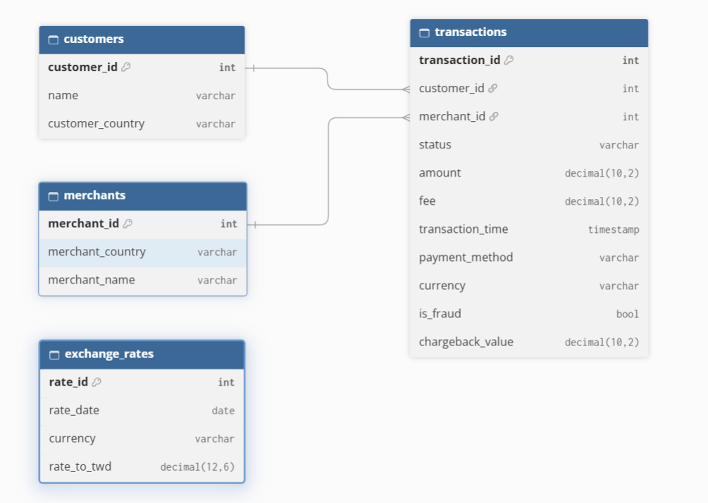

# Payments Analytics: Where Do Failures, Fees, and Fraud Cost a Payments Company?

This project aims to find where a payments company incurs losses using simulated data for 1,000 customers, 50 merchants and 50,132 transactions.

I designed the schema, cleaned the raw JSON in pandas, loaded it into PostgreSQL, and answered six questions using SQL covering failures, fees, volume, and fraud.

Convenience store and bank transfer payments fail the most at about 14% to 16%, and in this simulated data together they accounted for NT$7.1 million in failed value.

Cross-border payments fail about twice as often as domestic payments (about 12% compared to 5% to 6.5%) and the fees are one percentage point higher for cross-border payments.

I used a velocity rule of 5 transactions in 5 minutes that flagged 20 customers who accounted for all 132 fraud-labeled transactions and had a total of about NT$288,000 in chargebacks.

I used a generator script written with the help of AI to create the data and plant patterns. As a result, the findings show my method rather than actual rates.

## Business Questions

1. Which payment methods fail most, and how much payment value is at risk?
2. Do cross-border payments fail more than domestic ones?
3. Do customers who make many transactions within minutes show more fraud and chargebacks?
4. How much volume is domestic vs. cross-border, and what do Taiwan customers spend, in TWD, USD, and JPY (converted to TWD)?
5. How big are fees as a share of volume, by payment method and by cross-border vs. domestic?
6. Which merchants in each country bring in the most successful payment value?

## Definitions

- **Cross-border:** the customer's country is different from the merchant's country.
- **Velocity:** 5 or more transactions by one customer within 5 minutes and then retested at 2 minutes.
- **Failed value (revenue at risk):** the TWD value of payments that failed. The merchant did not get paid.
- **Cost:** fees paid on successful payments.
- **Loss:** chargeback value.

## Data Model



| Table | Role | One row is... |
|---|---|---|
| `transactions` | fact | one payment attempt |
| `customers` | dimension | one customer |
| `merchants` | dimension | one merchant |
| `exchange_rates` | lookup | one currency on one day |

`transactions` points to `customers` and `merchants` with foreign keys. `exchange_rates` has no foreign key from transactions. The exchange rate is identified by currency plus date, and transactions stores a timestamp, so the two are joined on currency and DATE(transaction_time).

## Data Generation

Python generated the data: 1,000 customers, 50 merchants, 50,132 transactions over 12 months (Nov 2025 to Oct 2026), and daily exchange rates for TWD, USD, and JPY. I used AI to help with the generator script. I designed the schema and business questions, then cleaned, loaded, and analyzed the data myself. The generator planted six patterns so each of my questions has something to find:

1. Failure rates differ by payment method.
2. Cross-border payments fail more often.
3. Twenty customers have fraud bursts (5 to 8 transactions within 4 minutes).
4. Customers mostly pay in their home currency.
5. Fee rates differ by payment method, and cross-border costs extra.
6. Some merchants are much busier than others.

## Raw vs. Clean

The generated data was saved as messy JSON, then cleaned in pandas before loading into PostgreSQL.

| Problem | Count | Fix |
|---|---|---|
| Duplicate transactions | 2,000 | removed (52,132 to 50,132 rows) |
| Inconsistent label case (status, payment method, customer country) | various | lowercased, then mapped to one spelling |
| Amounts stored as text (e.g. `"JPY 24,937.75"`) | various | stripped to numbers |
| Negative amounts | 248 | set to NULL |
| Nested merchant block | all rows | flattened into `merchant_id` |
| Missing fees | 1,518 | left as NULL |
| Missing payment methods | 951 | left as NULL, shown as `Unknown` in results |
| Timestamps stored as text | all rows | converted to datetime |

## Analysis

### Q1. Which payment methods fail most, and how much payment value is at risk?

One row per payment method. Payment methods with fewer than 100 attempts are excluded. Failed amounts are converted to TWD using the exchange rate on the day of the payment.

```sql
SELECT COALESCE(t.payment_method, 'Unknown') AS payment_method,
       COUNT(t.transaction_id) AS attempts,
       COUNT(CASE WHEN t.status = 'success' THEN 1 END) AS total_successful_txns,
       ROUND(100.0 * COUNT(CASE WHEN t.status = 'success' THEN 1 END)
             / NULLIF(COUNT(t.transaction_id), 0), 2) AS success_rate,
       ROUND(SUM(CASE WHEN t.status = 'failed' THEN t.amount * r.rate_to_twd END), 2) AS failed_value_twd
FROM transactions t
JOIN exchange_rates r
  ON r.currency = t.currency
 AND r.rate_date = DATE(t.transaction_time)
GROUP BY payment_method
HAVING COUNT(transaction_id) >= 100
ORDER BY success_rate DESC;
```

**Result:**

| Payment method | Attempts | Successful | Success rate (%) | Failed value (TWD) |
|---|---|---|---|---|
| apple pay | 8,262 | 7,732 | 93.59 | 1,572,640.85 |
| credit card | 8,039 | 7,501 | 93.31 | 1,554,864.46 |
| line pay | 8,298 | 7,575 | 91.29 | 2,200,199.47 |
| jkopay | 8,184 | 7,423 | 90.70 | 2,325,528.95 |
| Unknown | 951 | 853 | 89.70 | 272,515.40 |
| bank transfer | 8,360 | 7,184 | 85.93 | 3,400,791.47 |
| convenience store | 8,038 | 6,786 | 84.42 | 3,672,378.47 |

**Findings:**

- Convenience store payments have the lowest success rate and the largest failed value: **NT$3,672,378.47** over the year.
- Apple Pay has the highest success rate.
- Bank transfer has the second-lowest success rate. This comes from the failure rate planted in the simulation, and real bank transfers would likely perform better. See Limitations.
- Before trusting the numbers, I checked that the join to `exchange_rates` returned exactly 50,132 rows, the same as the transaction count, so no rows were lost or duplicated.

### Q2. Do cross-border payments fail more than domestic ones?

One row per customer country and transaction type (3 countries x 2 types = 6 rows). I grouped by the **customer's** country because that is where the customer is. Transaction type is domestic when the customer and merchant are in the same country, otherwise cross-border.

```sql
SELECT c.customer_country,
       CASE WHEN c.customer_country = m.merchant_country THEN 'domestic'
            ELSE 'cross-border' END AS transaction_type,
       COUNT(t.transaction_id) AS attempts,
       COUNT(CASE WHEN t.status = 'failed' THEN 1 END) AS failed_txns,
       ROUND(100.0 * COUNT(CASE WHEN t.status = 'failed' THEN 1 END)
             / NULLIF(COUNT(t.transaction_id), 0), 2) AS failure_rate
FROM customers c
JOIN transactions t ON c.customer_id = t.customer_id
JOIN merchants m ON m.merchant_id = t.merchant_id
GROUP BY c.customer_country,
         CASE WHEN c.customer_country = m.merchant_country THEN 'domestic'
              ELSE 'cross-border' END
ORDER BY c.customer_country, transaction_type;
```

**Result:**

| Customer country | Type | Attempts | Failed | Failure rate (%) |
|---|---|---|---|---|
| Japan | cross-border | 10,877 | 1,326 | 12.19 |
| Japan | domestic | 5,777 | 300 | 5.19 |
| Taiwan | cross-border | 10,105 | 1,223 | 12.10 |
| Taiwan | domestic | 5,979 | 388 | 6.49 |
| USA | cross-border | 12,371 | 1,519 | 12.28 |
| USA | domestic | 5,023 | 322 | 6.41 |

**Findings:**

- In every country, the cross-border failure rate is about **double** the domestic failure rate.
- Japan's domestic failure rate is about 1.2 to 1.3 percentage point lower than Taiwan's and the USA's. I view  this as normal random variation and not a significant difference.

### Q3. Do customers who make many transactions within minutes show more fraud and chargebacks?

A customer is **flagged** if any of their transactions is at least their 5th within 5 minutes. For each transaction I used `LAG(transaction_time, 4)` per customer to get the time of the transaction 4 positions earlier. If the gap is 5 minutes or less, the transaction is flagged. Customers with at least one flagged transaction are labeled `yes`, everyone else `no`. Chargebacks are converted to TWD using the exchange rate on the transaction date.

```sql
WITH with_gap AS (
    SELECT customer_id,
           transaction_time,
           transaction_time - LAG(transaction_time, 4)
               OVER (PARTITION BY customer_id ORDER BY transaction_time) AS gap
    FROM transactions
),
flagged AS (
    SELECT customer_id
    FROM with_gap
    WHERE gap <= INTERVAL '5 minutes'
    GROUP BY customer_id
),
labeled AS (
    SELECT c.customer_id,
           CASE WHEN f.customer_id IS NULL THEN 'no' ELSE 'yes' END AS group_label
    FROM customers c
    LEFT JOIN flagged f ON c.customer_id = f.customer_id
)
SELECT l.group_label,
       COUNT(DISTINCT l.customer_id) AS customers,
       COUNT(*) AS txns,
       COUNT(CASE WHEN t.is_fraud THEN 1 END) AS fraud_txns,
       ROUND(SUM(t.chargeback_value * r.rate_to_twd), 2) AS chargeback_total_twd
FROM labeled l
JOIN transactions t ON l.customer_id = t.customer_id
JOIN exchange_rates r
  ON r.currency = t.currency
 AND r.rate_date = DATE(t.transaction_time)
GROUP BY l.group_label;
```

**Result:**

| Flagged | Customers | Transactions | Fraud transactions | Chargebacks (TWD) |
|---|---|---|---|---|
| no | 980 | 49,000 | 0 | 0.00 |
| yes | 20 | 1,132 | 132 | 288,160.84 |

**Findings:**

- 20 customers triggered the 5-in-5-minutes rule. They account for all 132 fraud-labeled transactions and **NT$288,160.84** in chargeback losses. The other 980 customers had no fraud and no chargebacks.
- Tightening the window to 2 minutes (5+ transactions within 2 minutes) flagged only 8 customers (one with 4 flagged transactions, two with 3, and five with 1):

| Window | Flagged customers | Fraud txns caught | Chargebacks caught (TWD) |
|---|---|---|---|
| 5 minutes | 20 | 132 of 132 (100%) | 288,160.84 of 288,160.84 (100%) |
| 2 minutes | 8 | 58 of 132 (44%) | 110,671.29 of 288,160.84 (38%) |

  At 2 minutes, 74 fraud transactions and NT$177,489.55 in chargebacks sit with customers the rule did not flag. A tighter window raises fewer false alarms but misses slower bursts, so the window is a trade-off.
- Checks: 49,000 + 1,132 = 50,132, the full transaction count. Chargebacks must be converted to TWD before summing, because the raw amounts mix TWD, USD, and JPY (the unconverted total was much larger and meaningless).
- Caveat: the `is_fraud` label comes from the data generator, which marked the planted bursts as fraud. This shows the rule finds the planted bursts. It does not show that fast transactions predict fraud at a real company, where labels would come from chargebacks or review.

### Q4. How much volume is domestic vs. cross-border, and what do Taiwan customers spend in each currency?

**Part 1: domestic vs. cross-border volume.** Volume counts **successful transactions only**, converted to TWD. One row per customer country and transaction type (6 rows).

```sql
SELECT c.customer_country,
       CASE WHEN c.customer_country = m.merchant_country THEN 'domestic'
            ELSE 'cross-border' END AS transaction_type,
       COUNT(t.transaction_id) AS attempts,
       COUNT(CASE WHEN t.status = 'success' THEN 1 END) AS successful_txns,
       ROUND(100.0 * COUNT(CASE WHEN t.status = 'success' THEN 1 END)
             / NULLIF(COUNT(t.transaction_id), 0), 2) AS success_rate,
       ROUND(SUM(CASE WHEN t.status = 'success' THEN t.amount * r.rate_to_twd END), 2) AS success_value_twd
FROM customers c
JOIN transactions t ON c.customer_id = t.customer_id
JOIN merchants m ON m.merchant_id = t.merchant_id
JOIN exchange_rates r
  ON r.currency = t.currency
 AND r.rate_date = DATE(t.transaction_time)
GROUP BY c.customer_country,
         CASE WHEN c.customer_country = m.merchant_country THEN 'domestic'
              ELSE 'cross-border' END
ORDER BY c.customer_country;
```

**Result:**

| Customer country | Type | Attempts | Successful | Success rate (%) | Successful value (TWD) |
|---|---|---|---|---|---|
| Japan | cross-border | 10,877 | 9,551 | 87.81 | 28,962,847.63 |
| Japan | domestic | 5,777 | 5,477 | 94.81 | 16,668,202.83 |
| Taiwan | cross-border | 10,105 | 8,882 | 87.90 | 23,820,600.32 |
| Taiwan | domestic | 5,979 | 5,591 | 93.51 | 14,765,791.86 |
| USA | cross-border | 12,371 | 10,852 | 87.72 | 34,029,851.91 |
| USA | domestic | 5,023 | 4,701 | 93.59 | 15,104,422.75 |

**Findings:**

- Cross-border is 67% of attempts (33,353 of 50,132) and 65% of successful value (NT$86,813,299.86 of NT$133,351,717.30).
- The cross-border share of attempts is about 63% for Taiwan customers, 65% for Japan, and 71% for the USA.
- Domestic success rates are 93.5% to 94.8%, and cross-border rates are about 87.8%. The gap is about 6 percentage points, which matches the failure gap found in Q2.
- Checks: attempts add up to 50,132, the full transaction count. `amount` is NULL on the 248 cleaned negative rows, so the TWD values are slightly understated.

**Part 2: Taiwan customers' spend by currency.** Taiwan customers only, successful transactions only, one row per currency.

```sql
SELECT r.currency,
       COUNT(t.transaction_id) AS attempts,
       COUNT(CASE WHEN t.status = 'success' THEN 1 END) AS successful_txns,
       ROUND(100.0 * COUNT(CASE WHEN t.status = 'success' THEN 1 END)
             / NULLIF(COUNT(t.transaction_id), 0), 2) AS success_rate,
       ROUND(SUM(CASE WHEN t.status = 'success' THEN t.amount END), 2) AS spend_original,
       ROUND(SUM(CASE WHEN t.status = 'success' THEN t.amount * r.rate_to_twd END), 2) AS spend_twd
FROM customers c
JOIN transactions t ON c.customer_id = t.customer_id
JOIN exchange_rates r
  ON r.currency = t.currency
 AND r.rate_date = DATE(t.transaction_time)
WHERE c.customer_country = 'Taiwan'
GROUP BY r.currency
ORDER BY r.currency;
```

**Result:**

| Currency | Attempts | Successful | Success rate (%) | Spend (original currency) | Spend (TWD) |
|---|---|---|---|---|---|
| JPY | 1,577 | 1,411 | 89.47 | 21,791,796.02 | 4,531,974.74 |
| TWD | 12,871 | 11,561 | 89.82 | 29,167,302.48 | 29,167,302.48 |
| USD | 1,636 | 1,501 | 91.75 | 151,128.82 | 4,887,114.96 |

**Findings:**

- Taiwan customers spend 75.6% of their total (NT$29,167,302.48 of NT$38,586,392.18) in TWD. About a quarter (NT$9.4M) is in USD or JPY, so exchange-rate moves change the TWD value of that spend.
- The USD success rate is about 2 percentage points higher than JPY and TWD. With about 1,600 USD attempts, this is within normal random variation.
- Check: in the TWD row, the original and TWD spend are identical, because the TWD rate is 1.0.

### Q5. How big are fees as a share of volume, by payment method and by cross-border vs. domestic?

Fee share = fees ÷ volume, both converted to TWD, using **successful transactions that have both a fee and an amount**. Failed payments carry no fee. Rows with a missing fee or amount are excluded from both sums, so they cannot drag the percentage down. This leaves 43,462 of the 45,054 successful transactions.

```sql
SELECT COALESCE(t.payment_method, 'Unknown') AS payment_method,
       CASE WHEN c.customer_country = m.merchant_country THEN 'domestic'
            ELSE 'cross-border' END AS transaction_type,
       COUNT(*) AS txns,
       ROUND(SUM(t.fee * r.rate_to_twd), 2) AS fees_twd,
       ROUND(SUM(t.amount * r.rate_to_twd), 2) AS volume_twd,
       ROUND(100.0 * SUM(t.fee * r.rate_to_twd)
             / NULLIF(SUM(t.amount * r.rate_to_twd), 0), 2) AS fee_pct
FROM customers c
JOIN transactions t ON c.customer_id = t.customer_id
JOIN merchants m ON m.merchant_id = t.merchant_id
JOIN exchange_rates r
  ON r.currency = t.currency
 AND r.rate_date = DATE(t.transaction_time)
WHERE t.status = 'success'
  AND t.fee IS NOT NULL
  AND t.amount IS NOT NULL
GROUP BY payment_method,
         CASE WHEN c.customer_country = m.merchant_country THEN 'domestic'
              ELSE 'cross-border' END
ORDER BY payment_method, transaction_type;
```

**Result:**

| Payment method | Type | Txns | Fees (TWD) | Volume (TWD) | Fee share (%) |
|---|---|---|---|---|---|
| apple pay | cross-border | 4,847 | 533,062.17 | 14,411,231.77 | 3.70 |
| apple pay | domestic | 2,648 | 211,804.64 | 7,842,601.87 | 2.70 |
| bank transfer | cross-border | 4,468 | 237,060.82 | 13,172,624.35 | 1.80 |
| bank transfer | domestic | 2,445 | 57,807.18 | 7,193,717.10 | 0.80 |
| convenience store | cross-border | 4,254 | 318,074.81 | 12,725,729.98 | 2.50 |
| convenience store | domestic | 2,277 | 103,809.23 | 6,918,488.28 | 1.50 |
| credit card | cross-border | 4,727 | 550,264.61 | 14,110,532.25 | 3.90 |
| credit card | domestic | 2,536 | 219,596.51 | 7,567,493.52 | 2.90 |
| jkopay | cross-border | 4,623 | 385,236.14 | 13,766,021.57 | 2.80 |
| jkopay | domestic | 2,527 | 133,020.86 | 7,382,897.16 | 1.80 |
| line pay | cross-border | 4,812 | 461,814.09 | 14,432,534.34 | 3.20 |
| line pay | domestic | 2,482 | 161,316.61 | 7,325,674.57 | 2.20 |
| Unknown | cross-border | 521 | 47,815.00 | 1,583,146.89 | 3.02 |
| Unknown | domestic | 295 | 17,258.87 | 878,687.96 | 1.96 |

**Findings:**

- The highest fee shares are all cross-border: credit card at 3.90%, Apple Pay at 3.70%, and LINE Pay at 3.20%. The lowest are bank transfer domestic at 0.80% and convenience store domestic at 1.50%.
- Cross-border adds 1 percentage point to the fee share for every payment method. The `Unknown` rows differ by about 1.06 points because they blend several methods.
- Trade-off with Q1: the cheapest methods for the merchant (bank transfer and convenience store) are the ones with the lowest success rates, and the most expensive (credit card and Apple Pay) have the highest. Cross-border adds both a higher fee and a higher failure rate.

### Q6. Which merchants bring in the most successful payment value in each country?

"Top" means successful value in TWD, with failed value shown next to it. "Per country" is the customer's country, so each list shows where customers from that country spend the most. Merchants are grouped by `merchant_id`. Top 5 per country.

```sql
WITH merchant_totals AS (
    SELECT c.customer_country, m.merchant_id, m.merchant_name,
           ROUND(SUM(CASE WHEN t.status = 'success' THEN t.amount * r.rate_to_twd END), 2) AS success_value_twd,
           ROUND(SUM(CASE WHEN t.status = 'failed'  THEN t.amount * r.rate_to_twd END), 2) AS failed_value_twd
    FROM customers c
    JOIN transactions t ON c.customer_id = t.customer_id
    JOIN merchants m ON t.merchant_id = m.merchant_id
    JOIN exchange_rates r
      ON r.currency = t.currency
     AND r.rate_date = DATE(t.transaction_time)
    GROUP BY m.merchant_id, m.merchant_name, c.customer_country
),
ranked AS (
    SELECT customer_country, merchant_id, merchant_name,
           success_value_twd, failed_value_twd,
           RANK() OVER (PARTITION BY customer_country ORDER BY success_value_twd DESC) AS rnk
    FROM merchant_totals
)
SELECT customer_country, rnk, merchant_id, merchant_name, success_value_twd, failed_value_twd
FROM ranked
WHERE rnk <= 5
ORDER BY customer_country, rnk;
```

**Result:**

| Customer country | Rank | Merchant | Successful value (TWD) | Failed value (TWD) |
|---|---|---|---|---|
| Japan | 1 | Sunset Goods | 3,504,726.56 | 155,191.73 |
| Japan | 2 | Theresa's Mart | 3,452,233.84 | 207,376.03 |
| Japan | 3 | Northern Pharmacy | 3,329,732.69 | 458,202.00 |
| Japan | 4 | Trust Fashion | 3,285,301.66 | 436,636.46 |
| Japan | 5 | Theresa's Goods | 3,235,579.02 | 402,554.20 |
| Taiwan | 1 | Northern Pharmacy | 2,989,823.62 | 186,133.52 |
| Taiwan | 2 | Theresa's Goods | 2,894,715.31 | 386,104.77 |
| Taiwan | 3 | Theresa's Mart | 2,877,466.40 | 389,059.47 |
| Taiwan | 4 | Dawn Fashion | 2,868,446.25 | 230,716.33 |
| Taiwan | 5 | Trust Fashion | 2,814,817.25 | 198,979.57 |
| USA | 1 | Theresa's Goods | 3,792,842.29 | 309,772.80 |
| USA | 2 | Northern Pharmacy | 3,680,067.26 | 477,302.40 |
| USA | 3 | Trust Fashion | 3,594,450.30 | 532,569.89 |
| USA | 4 | Dawn Fashion | 3,547,538.87 | 479,416.64 |
| USA | 5 | Theresa's Mart | 3,456,282.68 | 542,955.53 |

**Findings:**

- Four merchants are in the top 5 of all three countries: Northern Pharmacy, Theresa's Goods, Theresa's Mart, and Trust Fashion. The same few merchants dominate everywhere. The generator gave some merchants more traffic than others, regardless of customer country.
- Revenue at risk differs a lot between the top merchants. In Japan, failed value as a share of successful value is 13.8% for Northern Pharmacy, 13.3% for Trust Fashion, 12.4% for Theresa's Goods, 6.0% for Theresa's Mart, and 4.4% for Sunset Goods.
- The two lowest ratios belong to Sunset Goods and Theresa's Mart, which are both Japan-based merchants (checked in the merchants table). That fits the domestic vs. cross-border gap in Q2, though I did not check the other three merchants' countries.

## Limitations

- The data is simulated and I made the AI generate patterns so I could use SQL to find them. 
- Payment retries are not modeled. A failed payment followed by a successful retry looks like one failure and one success.
- Exchange rates are a simple daily random walk, not real market rates.
- The fraud bursts were planted within 4 minutes, so the 5-minute rule catching all of them is built in, and the data has no legitimate fast buyers, so false alarms from a wider window are not tested.
- Each merchant's country was assigned at random, so roughly two-thirds cross-border volume is built in. Merchant traffic was also weighted at random, so the same few merchants lead every country.
- 248 amounts were set to NULL during cleaning, and 1,518 fees are missing. Value sums skip them, so TWD values are slightly understated, and the fee-share analysis in Q5 excludes those rows from both fees and volume.

## Tools

Python (pandas, SQLAlchemy), PostgreSQL, pgAdmin, dbdiagram.io.
